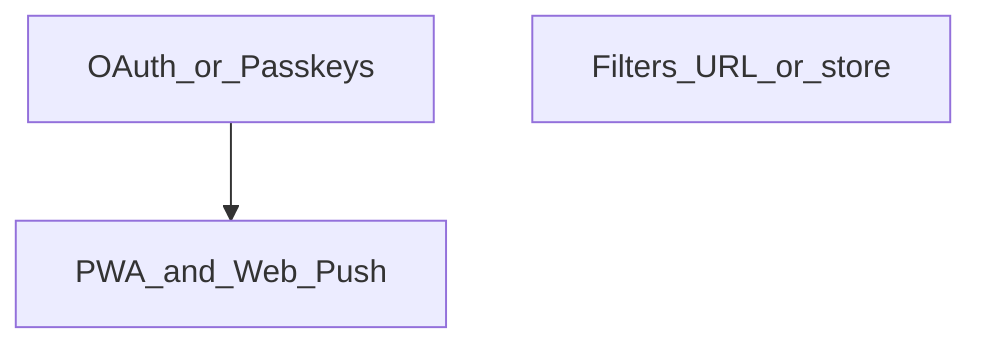

# Roadmap и бэклог

Незакрытые задачи, баги и идеи. Закрытое — в [DONE.md](./DONE.md).

Стек: Next.js (фронт), NestJS + JWT + Prisma (бэкенд); фильтры через URL (`useTransactionsFilters`, `useGroupSelector`).

Для закрытой тестовой среды «для себя» приоритет — блок **критично перед стендом** и, если в тесте будут семьи, **семейные группы**. Публичный прод — ещё безопасность, эксплуатация и право (реквизиты в `legal-public-meta.ts`).

---

## Критично перед тестовым деплоем

Ломают стенд или сессию. Без этого выкладка будет казаться «сломанной».

_Пункты блока закрыты — см. [DONE.md](./DONE.md)._

---

## Семейные группы (если в тесте не только соло)

_Пункты блока закрыты — см. [DONE.md](./DONE.md). Развёрнутый план и оставшийся техдолг по группам — в [TECH_DEBT.md](../../finance-track-back/docs/TECH_DEBT.md)._

---

## UX и мелкий продукт

_Пункты блока закрыты — см. [DONE.md](./DONE.md)._

---

## Открытые баги и продукт

| Приоритет | Задача                                      | Примечание                                                                                                                                                                                                                                                                                                                                                                                                                                                                                                                                                                                                                                                                                                                                                                                                                                                                                                                                                                                                                                                                                                                                                                                                                                                                                                                                                                                                                                                                                                                                                                                                                                                                                                                                                                                                                                                                                                                                                                                                                                                                                                                                                                                                                                                                                                                                                                                     |
| --------- | ------------------------------------------- | ---------------------------------------------------------------------------------------------------------------------------------------------------------------------------------------------------------------------------------------------------------------------------------------------------------------------------------------------------------------------------------------------------------------------------------------------------------------------------------------------------------------------------------------------------------------------------------------------------------------------------------------------------------------------------------------------------------------------------------------------------------------------------------------------------------------------------------------------------------------------------------------------------------------------------------------------------------------------------------------------------------------------------------------------------------------------------------------------------------------------------------------------------------------------------------------------------------------------------------------------------------------------------------------------------------------------------------------------------------------------------------------------------------------------------------------------------------------------------------------------------------------------------------------------------------------------------------------------------------------------------------------------------------------------------------------------------------------------------------------------------------------------------------------------------------------------------------------------------------------------------------------------------------------------------------------------------------------------------------------------------------------------------------------------------------------------------------------------------------------------------------------------------------------------------------------------------------------------------------------------------------------------------------------------------------------------------------------------------------------------------------------------- |
| Средний   | **Статистика группы по участникам**         | `GET /user-group/:id/stat` отдаёт сумму по групповым категориям за период и тип (доход или расход) сразу по всем, чьи категории сопоставлены. Разреза по человеку нет: нельзя посмотреть траты и доходы одного участника, только общую диаграмму. Нужен фильтр: вся группа, только я, конкретный участник — и для расходов, и для доходов. Операции уже хранят `userId`. Как показать разрез (фильтр поверх текущей диаграммы, доли участников или оба варианта) — продумать; список операций и диаграмма при одном и том же фильтре не должны расходиться.                                                                                                                                                                                                                                                                                                                                                                                                                                                                                                                                                                                                                                                                                                                                                                                                                                                                                                                                                                                                                                                                                                                                                                                                                                                                                                                                                                                                                                                                                                                                                                                                                                                                                                                                                                                                                                    |
| Средний   | **Калькулятор в сумме операции**            | В форме операции (`operation-form`) рядом с полем суммы нужен калькулятор: посчитать выражение прямо в приложении и сразу подставить результат в сумму. Сейчас сумма вводится только вручную.                                                                                                                                                                                                                                                                                                                                                                                                                                                                                                                                                                                                                                                                                                                                                                                                                                                                                                                                                                                                                                                                                                                                                                                                                                                                                                                                                                                                                                                                                                                                                                                                                                                                                                                                                                                                                                                                                                                                                                                                                                                                                                                                                                                                  |
| Средний   | **Удаление группы и выход из группы**       | На экране группы (`group-detail`) нет явных действий: создатель не может удалить группу, участник — выйти. Бэкенд: `DELETE /user-group/:id` уже есть (только создатель). Выход: `removeFromGroup` в сервисе есть, HTTP-эндпоинта нет (кик — `DELETE /user-group/:groupId/members/:memberId`, только создатель, себя убрать нельзя). Нужны кнопки с подтверждением: удалить группу (создатель) и «Выйти из группы» (участник, не создатель). После успеха — список групп. Когда удаление и выход будут готовы: `feature/group-row-actions` на `GroupCard` (как `operation-row-actions`) — у создателя «Редактировать» и «Удалить», у участника только «Выйти».                                                                                                                                                                                                                                                                                                                                                                                                                                                                                                                                                                                                                                                                                                                                                                                                                                                                                                                                                                                                                                                                                                                                                                                                                                                                                                                                                                                                                                                                                                                                                                                                                                                                                                                                  |
| Средний   | **Кнопки «Назад» на экранах**               | Пройтись по всем экранам и понять, где нужна кнопка «Назад». Очевидный случай: переход с главной в фильтр по категориям трат — оттуда сейчас нет явного пути назад. Проверить также детали и формы операций, категорий и групп, страницы профиля и настроек. Определить, где «Назад» ведёт на предыдущий экран (`router.back()`), а где на фиксированный родительский маршрут (если страницу открыли по прямой ссылке, истории может не быть). Оформить единым компонентом в `shared/ui`.                                                                                                                                                                                                                                                                                                                                                                                                                                                                                                                                                                                                                                                                                                                                                                                                                                                                                                                                                                                                                                                                                                                                                                                                                                                                                                                                                                                                                                                                                                                                                                                                                                                                                                                                                                                                                                                                                                      |

---

## Безопасность (ещё открыто)

IDOR по операциям/категориям и базовый auth — в [DONE.md](./DONE.md).

| Приоритет | Задача | Примечание |
| --------- | ------ | ---------- |
| Низкий | **Политика паролей** | Сейчас минимум 6 символов. |
| Низкий | **Шифрование чувствительных данных** | Подумать, какие поля реально стоит шифровать. Не усложнять приложение ради шифрования того, что не является приоритетом. |

---

## Эксплуатация и деплой

Упаковка стенда, HTTPS, секреты вне git и бэкапы по расписанию — в [DONE.md](./DONE.md).

| Приоритет | Задача                     | Примечание                                                                                                                                                                                                 |
| --------- | -------------------------- | ---------------------------------------------------------------------------------------------------------------------------------------------------------------------------------------------------------- |
| Высокий   | **Мониторинг и алерты**    | `/health` проверяет БД — [DONE.md](./DONE.md). Нет **внешних** алертов (uptime, 5xx nginx, диск, «дамп не создался» → Telegram/email).                                                                  |
| Высокий   | **Российский SMTP и почтовый сервис** | Подготовить всё для отправки почты через российский SMTP (переменные окружения, конфиг, тестовая отправка с стенда). Сравнить сервисы (Unisender, Sendsay, Mail.ru for Business, Yandex 360 и др.): цена, доставляемость, лимиты, API/SMTP, поддержка транзакционных писем (регистрация, сброс пароля, инвайты). Выбрать оптимальный и зафиксировать в `.env.example` / `DEPLOY.md`. |
| Средний   | **Откат на проде**         | Процедура в `DEPLOY.md` §5 — [DONE.md](./DONE.md). Остаётся один раз отработать на реальном стенде при учебном откате (не только локальный verify).                                                      |
| Средний   | **CI/CD вместо ручного обновления** | Сейчас выкладка — зайти на сервер, `git pull` в обоих репозиториях и `docker compose -f docker-compose.prod.yml up -d --build` ([DEPLOY.md](../../finance-track-back/docs/DEPLOY.md) §4). Продумать, как обновлять стенд автоматически: триггер (пуш в основную ветку или тег), сборка образов, миграции, проверка `/health` и что делать, если она не прошла. Учесть два репозитория и секреты вне git. Сначала схема, потом реализация. |

### Критерий «можно открывать шире бету»

- Закрыт блок **критично перед тестовым деплоем**.
- Если в тесте семьи — закрыт блок **семейные группы**.
- Бэкапы крутятся по расписанию — [DONE.md](./DONE.md). Есть способ узнать, что API/БД легли (мониторинг).
- SMTP настроен или сознательно не используется.
- Юр. тексты вынесены; перед широким запуском — прод-URL/реквизиты в `legal-public-meta.ts`.

---

## Техдолг бэкенда

Рефакторинг модулей, HTTP-слоя, групп, транзакций, auth и тестов — в репозитории API: **[finance-track-back/docs/TECH_DEBT.md](../../finance-track-back/docs/TECH_DEBT.md)**.

Задачи бэка с высоким приоритетом перед стендом остаются в таблицах выше (**«Критично перед тестовым деплоем»**, **«Семейные группы»**, **«Безопасность»**); в TECH_DEBT — развёрнутые «сделать / критерий» без дублирования всего ROADMAP.

---

## Приоритетный бэклог (крупные темы)

### 1. Фильтрация статистики и операций: стор или рефакторинг URL

**Что:** Один источник правды для периода, типа, категории; список операций и статистика не разъезжаются.

**Сейчас:** `src/feature/operation-filters/model/use-transactions-filters.ts` и `src/feature/group-selector/model/use-group-selector.ts` — URL (`type`, `period`, `startDate`, `endDate`, `categoryId`, `groupId`).

**Стор (Zustand и т.п.), если нужно:** синхронизация вкладок без URL; меньше `router.push` и гонок с `useEffect`; состояние вне одного route.

**Альтернатива:** единый разбор `URLSearchParams`, URL остаётся source of truth.

**Критерий:** нет дублирования список/статистика; шаринг ссылки сохраняет фильтры. Сложность: S–M.

### 2. Другие способы авторизации

Сейчас: email + пароль, JWT, refresh по `deviceId`.

Направления: OAuth2 (Google / Apple / GitHub), magic link, Passkeys / WebAuthn. Самописный `auth` vs Clerk/Auth0/Supabase.

Транзакционная почта уже есть — примитивы для magic link готовы, продуктово это отдельно. Сложность: M–L.

### 3. PWA и Web Push

Базовый профиль готов. Дальше напоминания («время внести расходы»).

| Часть          | Содержание                                                                |
| -------------- | ------------------------------------------------------------------------- |
| **PWA**        | `manifest` уже есть; нужен service worker, офлайн/кэш по необходимости.   |
| **Web Push**   | разрешение, subscription на бэкенде, VAPID, эндпоинты подписки.           |
| **Расписание** | cron/worker на сервере; клиентский таймер при закрытой вкладке ненадёжен. |
| **UI**         | время и вкл/выкл в профиле.                                               |

Сложность: M–L.

---

## Идеи развития

| Направление                                             | Зачем                                                                                                        |
| ------------------------------------------------------- | ------------------------------------------------------------------------------------------------------------ |
| **Роли в группе** (владелец / редактор / только чтение) | В схеме нет `role` / `permission`. Для «только семья» терпимо; для чужих в одной группе — почти обязательно. |
| **Краткосрочная группа / «событие»**                    | Отдельный тип группы для поездок, вечеринок, мероприятий: общие траты, кто что оплатил, в конце — расчёт «кто кому сколько должен» (упрощённые переводы между участниками). Не семейный бюджет на годы, а закрываемый цикл. Уровень идеи. |
| **Повторяющиеся операции**                              | Подписки, аренда.                                                                                            |
| **Бюджеты / лимиты по категории**                       | После статистики.                                                                                            |
| **Импорт трат из файла** (Excel, PDF, выгрузка банка и др.) | Перенос операций из внешних источников с сопоставлением с текущими категориями и группами пользователя. Уровень идеи: формат, парсинг и маппинг ещё не продуманы. |
| **Напоминания о записи трат**                           | Уведомления с настраиваемым временем; по умолчанию выключены. См. также блок «PWA и Web Push» в приоритетном бэклоге. |
| **Реакции и комментарии к операциям**                   | Реакции на траты других участников группы или комментарии к операциям; при событиях — уведомления.           |
| **Несколько валют + курс**                              | Если не только RUB.                                                                                          |
| **Полнотекстовый поиск**                                | Комментарии и суммы, когда операций много.                                                                   |
| **Email-дайджесты**                                     | Отдельно от push.                                                                                            |
| **2FA**                                                 | При усилении безопасности.                                                                                   |

---

## Зависимости

Упаковка стенда закрыта. Дальше — OAuth/Passkeys и PWA. Фильтры автономны. Роли в группе — из таблицы идей, без жёсткой стрелки.

---

