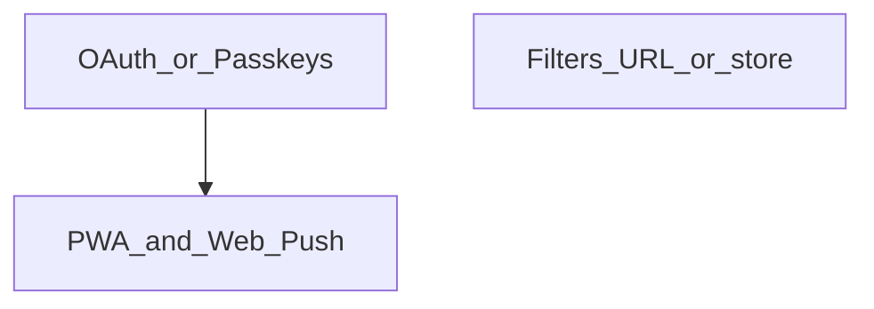

# Roadmap и бэклог

Незакрытые задачи, баги и идеи. Закрытое — в [DONE.md](./DONE.md).

Стек: Next.js (фронт), NestJS + JWT + Prisma (бэкенд); фильтры через URL (`useTransactionsFilters`, `useGroupSelector`).

Для закрытой тестовой среды «для себя» приоритет — блок **критично перед стендом** и, если в тесте будут семьи, **семейные группы**. Публичный прод — ещё безопасность, эксплуатация и право (реквизиты в `legal-public-meta.ts`).

---

## Критично перед тестовым деплоем

Ломают стенд или сессию. Без этого выкладка будет казаться «сломанной».

_Пункты блока закрыты — см. [DONE.md](./DONE.md)._

---

## Семейные группы (если в тесте не только соло)

_Пункты блока закрыты — см. [DONE.md](./DONE.md). Развёрнутый план и оставшийся техдолг по группам — в [TECH_DEBT.md](../../finance-track-back/docs/TECH_DEBT.md)._

---

## UX и мелкий продукт

_Пункты блока закрыты — см. [DONE.md](./DONE.md)._

---

## Безопасность (ещё открыто)

IDOR по операциям/категориям и базовый auth — в [DONE.md](./DONE.md).

| Приоритет | Задача                       | Примечание                                                      |
| --------- | ---------------------------- | --------------------------------------------------------------- |
| Низкий    | **Политика паролей**         | Сейчас минимум 6 символов.                                      |
| Низкий    | **ValidationPipe whitelist** | Сейчас extra-поля с клиента не отсекаются.                      |

---

## Эксплуатация и деплой

Упаковка стенда, HTTPS и секреты вне git — в [DONE.md](./DONE.md). Скрипты бэкапа — там же; на сервере расписание ещё не включено.

| Приоритет | Задача                     | Примечание                                                                                                                                                                                                 |
| --------- | -------------------------- | ---------------------------------------------------------------------------------------------------------------------------------------------------------------------------------------------------------- |
| Критично  | **Бэкапы на стенде/проде** | Скрипты, проверка дампа и `verify-backup-restore.sh` — в [DONE.md](./DONE.md). На сервере: cron + `check-backup-freshness.sh`, один раз прогнать verify на стенде.                                       |
| Высокий   | **Мониторинг и алерты**    | `/health` проверяет БД — [DONE.md](./DONE.md). Нет **внешних** алертов (uptime, 5xx nginx, диск, «дамп не создался» → Telegram/email).                                                                  |
| Средний   | **Откат на проде**         | Процедура в `DEPLOY.md` §5 — [DONE.md](./DONE.md). Остаётся один раз отработать на реальном стенде при учебном откате (не только локальный verify).                                                      |

### Критерий «можно открывать шире бету»

- Закрыт блок **критично перед тестовым деплоем**.
- Если в тесте семьи — закрыт блок **семейные группы**.
- Бэкапы крутятся по расписанию, есть способ узнать, что API/БД легли.
- SMTP настроен или сознательно не используется.
- Юр. тексты вынесены; перед широким запуском — прод-URL/реквизиты в `legal-public-meta.ts`.

---

## Техдолг бэкенда

Рефакторинг модулей, HTTP-слоя, групп, транзакций, auth и тестов — в репозитории API: **[finance-track-back/docs/TECH_DEBT.md](../../finance-track-back/docs/TECH_DEBT.md)**.

Задачи бэка с высоким приоритетом перед стендом остаются в таблицах выше (**«Критично перед тестовым деплоем»**, **«Семейные группы»**, **«Безопасность»**); в TECH_DEBT — развёрнутые «сделать / критерий» без дублирования всего ROADMAP.

---

## Приоритетный бэклог (крупные темы)

### 1. Фильтрация статистики и операций: стор или рефакторинг URL

**Что:** Один источник правды для периода, типа, категории; список операций и статистика не разъезжаются.

**Сейчас:** `src/feature/operation-filters/model/use-transactions-filters.ts` и `src/feature/group-selector/model/use-group-selector.ts` — URL (`type`, `period`, `startDate`, `endDate`, `categoryId`, `groupId`).

**Стор (Zustand и т.п.), если нужно:** синхронизация вкладок без URL; меньше `router.push` и гонок с `useEffect`; состояние вне одного route.

**Альтернатива:** единый разбор `URLSearchParams`, URL остаётся source of truth.

**Критерий:** нет дублирования список/статистика; шаринг ссылки сохраняет фильтры. Сложность: S–M.

### 2. Другие способы авторизации

Сейчас: email + пароль, JWT, refresh по `deviceId`.

Направления: OAuth2 (Google / Apple / GitHub), magic link, Passkeys / WebAuthn. Самописный `auth` vs Clerk/Auth0/Supabase.

Транзакционная почта уже есть — примитивы для magic link готовы, продуктово это отдельно. Сложность: M–L.

### 3. PWA и Web Push

Базовый профиль готов. Дальше напоминания («время внести расходы»).

| Часть          | Содержание                                                                |
| -------------- | ------------------------------------------------------------------------- |
| **PWA**        | `manifest` уже есть; нужен service worker, офлайн/кэш по необходимости.   |
| **Web Push**   | разрешение, subscription на бэкенде, VAPID, эндпоинты подписки.           |
| **Расписание** | cron/worker на сервере; клиентский таймер при закрытой вкладке ненадёжен. |
| **UI**         | время и вкл/выкл в профиле.                                               |

Сложность: M–L.

---

## Идеи развития

| Направление                                             | Зачем                                                                                                        |
| ------------------------------------------------------- | ------------------------------------------------------------------------------------------------------------ |
| **Роли в группе** (владелец / редактор / только чтение) | В схеме нет `role` / `permission`. Для «только семья» терпимо; для чужих в одной группе — почти обязательно. |
| **Мультитенантность**                                   | Не путать с i18n: tenant и изоляция, если понадобится SaaS.                                                  |
| **Экспорт / импорт (CSV)**                              | Резерв и перенос из других приложений.                                                                       |
| **Повторяющиеся операции**                              | Подписки, аренда.                                                                                            |
| **Бюджеты / лимиты по категории**                       | После статистики.                                                                                            |
| **Статистика по участникам группы**                     | Кто сколько потратил за период; операции уже с автором.                                                      |
| **Предупреждение при смене дефолтной категории**        | Влияет на сопоставление групповых категорий с личными.                                                       |
| **Несколько валют + курс**                              | Если не только RUB.                                                                                          |
| **Полнотекстовый поиск**                                | Комментарии и суммы, когда операций много.                                                                   |
| **Email-дайджесты**                                     | Отдельно от push.                                                                                            |
| **2FA**                                                 | При усилении безопасности.                                                                                   |
| **Интеграции с банками**                                | Дорого в поддержке.                                                                                          |

---

## Зависимости

Упаковка стенда закрыта. Дальше — OAuth/Passkeys и PWA. Фильтры автономны. Роли в группе — из таблицы идей, без жёсткой стрелки.

---

